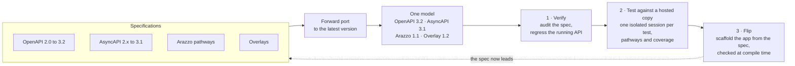
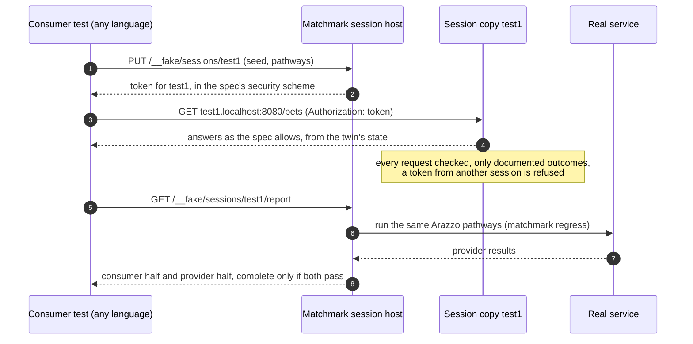
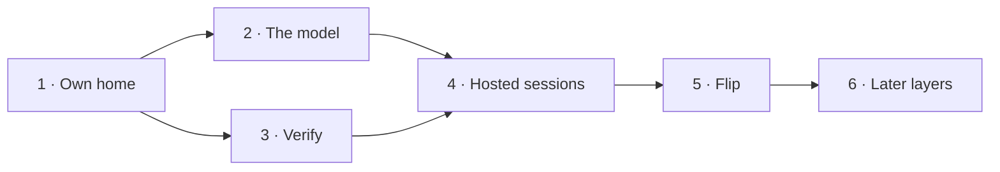

# Vision

*Matchmark*: match marks are scored across parts before they're separated, so they go back together exactly as they
fitted. Here the API specification makes the marks, and every implementation of it, and every consumer of it, must
still line up with them.

Where this project is going, and why. [CONCEPT.md](CONCEPT.md) describes how the prototype works today,
[PETSTORE.md](PETSTORE.md) walks through the sample, and the [README](README.md) covers the mechanics.

## The problem

An API has three descriptions of itself, and they drift apart:

- **The spec** says what the API should do.
- **The code** decides what it actually does.
- **The tests** check whatever someone thought to check.

Code-first tools keep the spec in step by deriving it from the code, so the spec records accidents as well as
decisions. Spec-first tools generate a skeleton once and then lose track of it. Neither keeps all three in step, and
none can say which documented behaviours the tests actually reach.

The same drift happens between teams. A backend and a frontend each test against their own picture of the API, and
nobody can say whether the two pictures cover the same journeys.

## The thesis

The spec should be an **enforceable contract** for the whole life of an API. It should fix everything except the
behaviour inside each operation, and independent checks should prove that the code, the running service, the tests and
the consumers all match it:

- **The compiler** proves completeness. Every documented outcome is a case of a union, so leaving one unhandled
  doesn't compile and returning an undocumented one can't be written.
- **The round trip** proves the running service describes itself exactly as the spec does.
- **Conformance** proves every response a caller sees is one the spec allows.
- **Outcome coverage** proves the tests reach every documented behaviour.
- **Pathway coverage** proves the consumers exercise every journey the provider says they must.

The contract is an interface (`IPetsHandlers`), not an HTTP surface. The service, the HTTP client, the twin, test fakes
and adapters to legacy systems are all implementations of it. One test suite runs against any of them.

## What it becomes

Matchmark starts where most teams are: with a spec they already have. It builds outwards in three steps, each useful
on its own, and each a step closer to the spec being the source the application derives from.

### 1. Verify a spec you already have

- **The spec on its own.** It reads, its examples match their schemas, and every operation can be generated.
  `matchmark audit` reports what it leaves out, measured in the test cases each fix would add, as text, SARIF or a
  Spectral ruleset.
- **A running API against the spec.** `matchmark regress` sends the suite the spec writes for itself: its examples,
  its bounds, one broken constraint at a time, and the workflows its links and Arazzo documents describe. Every
  response is checked. It needs a spec and a URL, nothing from the service, and works for an API in any language.
- **Events too.** An AsyncAPI document gets the same treatment: a consumer is held to its suite through a broker bridge,
  and every message a producer sends is checked against its message.
- **Any version.** Older specs are forward-ported on read, and `matchmark upgrade` writes the migrated spec, listing
  what changed and anything it couldn't carry across.

### 2. Test against a hosted copy of the API

A C# server hosts a copy of the API for every test session. Frontend, mobile and service tests in any language reach it
over HTTP; .NET tests get a framework helper that does the setup in one line.

- **One copy per session, addressed by host.** `test1.localhost:8080` reaches session `test1`, so paths stay exactly as
  the spec writes them and the application under test needs only its host changed.
- **The consumer starts the session.** It supplies the id, and starting a session stands in for logging in: it issues
  a token in whatever form the spec's security scheme requires. A token presented to another session's copy is refused,
  so parallel tests can't cross-talk.
- **Each copy is a twin with a script on top.** State comes from a twin inferred from the spec and seeded per test, so a
  `POST` followed by a `GET` round-trips. Scripted outcomes (`Given`) force the errors a test wants, and expected calls
  (`Should`) fail the first wrong one. Only documented outcomes can be scripted.
- **Events per session too.** WebSocket channels (`ws://test1.localhost:8080/...`) and broker channels are separate for
  each session, and every message is checked against its AsyncAPI message.
- **Pathways are the contract between teams.** Server engineers publish Arazzo workflows next to the spec: the journeys
  a consumer must support. The session counts which workflows, steps and outcomes its traffic completed.
- **Complete from both directions.** At the end of a run the session reports two halves: the consumer covered its
  pathways and sent only valid, expected calls; and the real service passes the same pathways. A run is complete only
  when both pass.
- **Parts swap at the contract.** The real service, the twin and the scripted fake all implement the generated handler
  interface, and the host picks one per session. Nothing else is split until swapping it would be a low-cost
  abstraction.

### 3. Flip: the spec leads, the application follows

- **Start from what exists.** Take the application's spec, or derive one from the document ASP.NET Core already
  generates from it. Verify the application against it (step 1).
- **Then flip ownership.** The spec becomes the source. Scaffolding writes ordinary ASP.NET controllers or Minimal API
  endpoints and a reference implementation, and the generated contract makes the compiler show every handler and
  consumer a spec change reaches.
- **Owned code stays honest.** The generator checks hand-written controllers and Map calls against the spec at compile
  time: a missing operation, an undocumented endpoint, a response or name that differs, or a parameter bound from the
  wrong place, with the wrong type or as required when it's optional, is a build error at the line that's wrong.
  Hand-written models are compared with their schemas, constraints included.
- **Events flip the same way.** Consumers and producers are generated from the AsyncAPI document as typed interfaces,
  with a transport adapter per broker.
- **Consumers get a typed client** in which every error is a case they must handle, and breaking changes are judged
  against what consumers actually use, not against the whole spec.

### Later: twins of APIs you don't own

A twin is the hosted copy grown up: a fake that remembers, measured against the real thing.

- ✓ **Stateful** (`SpecTwin`, from the spec alone). Resources are inferred from paths, so lists, paging, ETags and
  deletes behave as the spec's conventions say.
- ✓ **Measured** (`RegressionReport.Fidelity`, `matchmark fidelity`). The same sequences run against the real API and
  the twin; the share of steps that match is its fidelity score, with a floor in CI that only rises. Pull-request
  builds replay recorded responses, so they need no credentials.
- **Grown through a gated loop.** Each mismatch becomes a task. A writer, a person or any agent, adds behaviour in the
  twin's owned code, and the change is kept only if fidelity rises on held-out sequences the writer never saw and no
  operation falls. ✓ The loop exists (`FidelityLoop`, `matchmark fidelity --tasks --gate`), and an independent agent
  has run it on the Ledger twin, raising held-out fidelity from 61.9% to 85.7%.
- **An early warning.** When a twin's score drops and nobody changed the twin, the real API changed.
- **Shared.** A twin of a popular API is a package anyone can reference, published with its fidelity score.

## Principles

1. **Decisions belong in the spec.** Status codes, errors and constraints are API design, not implementation side
   effects. Anything the spec can't express belongs in an extension or an overlay, never in a hidden convention.
2. **The compiler is the first test.** Use types to make wrong code fail to build. Leave runtime checks for what types
   cannot express.
3. **Errors are data.** Every documented failure is a value with a type, on the server and in the client. No outcome is
   only a status code to remember.
4. **One contract, many implementations.** Server, client, twin, fake and legacy adapter implement the same interface.
   Tests target the interface.
5. **Every check is checked.** A gate counts only if breaking the thing it guards makes it fail; each one here was
   broken on purpose to prove it. Nothing is excused silently: when the generated output and the spec differ, the
   difference is fixed or named.
6. **Nothing generated is edited by hand.** Code is generated at build time and never checked in, so it can't drift from
   its spec or overwrite anyone's changes.
7. **Adoptable one step at a time.** Each step is useful on its own, starting with verifying a spec that already exists.
8. **.NET first, any stack served.** Matchmark is a .NET product and generates C#. Everything that checks an API or
   stands in for one works over HTTP, so it serves consumers in any language. Other languages come later, if at all,
   as more outputs of the same model.
9. **One model, the latest versions.** Every output is generated from one model, which holds the latest version of each
   format. Older versions arrive by forward porting, and Matchmark writes whichever version a consumer needs.
10. **Agents write twins, never services.** The behaviour inside a service's operations belongs to its team. Agent-written
    behaviour is confined to twins, and kept only when the fidelity gate says it helped.

## Specifications and versions

Matchmark supports the whole family in full: every construct in a supported version is read, anything it can't yet
generate is reported by name, and support is measured against each specification's official examples, with a number
that only rises. GraphQL, gRPC and Protocol Buffers are different paradigms and stay out of scope until someone needs
them.

| Format | Model holds | Read by forward porting | Library | Today |
|:--|:--|:--|:--|:--|
| OpenAPI | 3.2 | 2.0, 3.0, 3.1 | Microsoft.OpenApi | 2.0 to 3.2 read; the engine still normalises to 3.1 |
| AsyncAPI | 3.1 | 2.x, 3.0 | `asyncapi/net-sdk`, with an Oxbow fork for 3.1 | Matchmark's own reader; 2.x forward-ported by Matchmark's port of the official migration guide |
| Arazzo | 1.1 | 1.0 | BinkyLabs.OpenApi.Arazzo, with an Oxbow fork for 1.1 | Matchmark's own reader, 1.0 and 1.1 |
| Overlay | 1.2 | 1.0, 1.1 | BinkyLabs.OpenApi.Overlays, with an Oxbow fork for 1.2 | Matchmark's own implementation, 1.0 to 1.2 |

- **What's viable.** An older version is supported when a maintained converter or an official migration guide covers
  it, and upgrading loses nothing the generated code or the tests rely on. Anything else is reported as unsupported,
  naming the version and why.
- **How long.** A version stays supported for as long as a supported .NET release emits it: ASP.NET Core 10 writes
  OpenAPI 3.1 and .NET 11 writes 3.2, so both are first-class today. When a specification releases a new version, the
  model moves to it and the version it replaces becomes one more forward-port input.
- **Writing down.** Where a consumer needs an older version (3.1 for ASP.NET Core 10), Matchmark writes it, converting
  down where nothing is lost and reporting anything that is, as ASP.NET Core does when it writes `QUERY` into 3.1
  documents as `x-oai-additionalOperations`.
- **Standard libraries first.** Where a library falls short of the model's version, it is forked with
  [Oxbow](https://github.com/rtkelly-labs/oxbow): upstream plus a short stack of recorded changes, each written so
  upstream could take it and dropped once upstream does. If a BinkyLabs library proves insufficient, Matchmark gets a
  reader of its own for that format instead. Matchmark's current readers are retired only when their replacement passes
  the same tests.
- **The support matrix is generated.** Format and version against read, verify, host, generate and write, each cell
  backed by a test and published from the latest run.

## What we learn from others

| From | Idea | How it lands here |
|:--|:--|:--|
| [Kiota](https://learn.microsoft.com/en-us/openapi/kiota/extending/architecture), [Smithy](https://smithy.io/2.0/) | A language-neutral model between the definition and the code | A small model of operations, outcome unions, schemas and traits. The specifications are inputs; the contract, server, client, sessions and tests are outputs. |
| [Smithy protocol compliance tests](https://smithy.io/2.0/additional-specs/http-protocol-compliance-tests.html) | Tests are data inside the definition | The spec's `examples`, and malformed requests, become generated cases in the suite. |
| Smithy traits, [TypeSpec](https://typespec.io/docs/emitters/openapi3/openapi/) decorators | Meaning the base format can't express | Retryable errors, pagination and idempotency as extensions, turned into client behaviour, server behaviour and test properties. |
| [OpenAPI Overlays](https://spec.openapis.org/overlay/v1.0.0) | Changes to a spec kept in a separate file | Behaviour and generator hints live outside the public spec. |
| [buf breaking rules](https://buf.build/docs/breaking/rules/) | "Breaking" depends on who is affected | Every spec change is graded twice: does it break generated code, and does it break the JSON on the wire? |
| Pact | Consumers state what they rely on | Pathways run in both directions: the provider publishes them, the consumer's session proves it covered them, and the real service proves it passes them. No pact files to write. |
| [Mock Service Worker](https://mswjs.io/) | Tests talk to a fake at the network edge, with no change to the app | Sessions do the same from one C# server, reached by host, so any stack can use them without an in-process interceptor. |
| TypeSpec versioning | Many versions from one source | v1 and v2 contracts side by side, with generated adapters. |
| [Effect HttpApi](https://effect.website/docs/v4/api/openapi-generator/HttpApiTransformer) | One definition drives the server, client and docs, in either direction | Spec-first versus code-first stops mattering once the round trip is enforced. |

**What we don't take:** a separate definition language as a requirement (TypeSpec and Smithy are welcome as *inputs*),
template generators' sprawl of options, and reflection that nothing checks.

## Roadmap

The steps are in order. Each ends in something a person outside this repository can use, or a number that can be
checked.

**Done in the prototype.** These carry over to every step below.
- ✓ The generated contract: types, outcome unions and handler interfaces, with request validation.
- ✓ The round-trip check against ASP.NET Core's own document, with no differences excused.
- ✓ A typed client that implements the contract and checks every response, with a lenient mode.
- ✓ One contract suite run in-process and over HTTP, with outcome coverage.
- ✓ A generated fake, scenarios of expected calls, and a fake server with isolated sessions (at `/sessions/{id}/`,
  with server-chosen ids).
- ✓ Scaffolded owned source, verified against the spec at compile time.
- ✓ A regression suite from the spec, every check proven by an injected fault, with random inputs that shrink, a
  differential runner, and Arazzo workflows run as stateful tests.
- ✓ Conformance middleware in two modes: *observe* in production, *enforce* in tests.
- ✓ `matchmark diff`: each change graded as breaking, breaking generated code, or additive.
- ✓ AsyncAPI 3: a consumer's suite, a producer's messages checked, typed messages generated, Arazzo message steps.
- ✓ OpenAPI 3.2: `QUERY`, streamed items as typed streams, `in: querystring`.
- ✓ A corpus of nine specs with a ledger, and GitHub's and Stripe's specs at 98.7% and 99.8% generated.
- ✓ The twin, fidelity runs and the gated agent loop (see Later, above).

**1. Own home.**
- Matchmark moves to its own repository, with its history.
- Generated contracts use plain unions by default; Resultful and OneOf become an opt-in adapter.

**2. The model.** Before any new output.
- A small semantic model of operations, outcomes, schemas and traits, at the latest version of each format.
- Parsing as its own incremental step, with output per tag, so one edit doesn't regenerate everything.
- The model tested directly, independent of any output. The emitter (3,979 lines in one class today) is split onto it.

**3. Verify.** Alongside step 2: it lives in the engine, which is separate from the generator.
- Every version in the table above read, through the standard libraries and their Oxbow forks.
- ✓ `matchmark upgrade`, and forward porting on every read (AsyncAPI 2.x included), with losses reported.
- ✓ The support matrix, generated from the tests ([docs/reference/support-matrix.md](docs/reference/support-matrix.md)).
- Support measured against the official example sets.
- The CLI as a dotnet tool and a container image.

**4. Hosted sessions.**
- ✓ Host-based routing, consumer-chosen session ids and session tokens in the spec's security scheme
  (`matchmark host`, `UseMatchmarkSessions`).
- ✓ Each session a seeded twin with scripted outcomes on top. Expected calls per session are next.
- ✓ Arazzo pathways, pathway coverage, and the two-sided report, the provider's half from `matchmark regress --save`.
- WebSocket and broker channels per session.
- ✓ `MatchmarkSession` for .NET tests, and the HTTP control API for everything else. Per-framework fixtures are next.
- ✓ A session whose copy is the real service, with an ephemeral database per session (EF Core and SQLite in the Pet
  Store); the built-in twin stays the default store.
- The generated fake hub moved onto the session host.

**5. Flip.**
- A spec derived from ASP.NET Core's own document, the application verified against it, then scaffolded from it.
- AsyncAPI consumers and producers generated as typed interfaces, with one broker adapter first.
- `matchmark diff` in pull requests, fed the outcomes consumers actually observed.
- Tried end to end on one real service with a frontend.

**6. Later layers.**
- Twins measured on a schedule against a real sandbox, with drops reported as upstream changes.
- The agent loop run unattended, with any writer.
- Twins published as packages, each with its fidelity score.
- Other hosts, such as Azure Functions or AWS Lambda, through the model.
- Versioned contracts with generated adapters.

## How we'll know it's working

- **A spec someone already has gets a verified suite in a day,** with no change to the service.
- **A frontend test starts against its own session in minutes,** before the service exists, and its pathways carry
  over to the real one unchanged.
- **Every run reports both halves:** the consumer covered its pathways, and the provider passes them.
- **A spec change reaches every affected handler and consumer as a compile error** before it reaches a reviewer,
  whether the HTTP layer is generated or written by hand.
- **Teams can state their outcome coverage,** and it's above 90%.
- **Undocumented responses seen in production trend to zero** once observe mode is on.
- **A breaking change to a used outcome can't merge** without a new version.
- **The support matrix only gains cells.**
- **Every twin states its fidelity to the real API,** the number only goes up, and a drop is noticed before a
  consumer's production traffic notices it.

## Out of scope

- **Generating a service's behaviour.** The behaviour inside an operation is the one thing deliberately left free; it
  belongs to the service's team. A twin's behaviour is the exception: it is generated for CRUD and written beyond it
  through the fidelity gate.
- **Replacing ASP.NET Core.** The server part generates ordinary Minimal API endpoints.
- **Other paradigms, for now.** GraphQL, gRPC and Protocol Buffers.
- **Other languages' code, for now.** Consumers in any language use Matchmark over HTTP; it generates C#.
- **Silent gaps.** Anything not yet supported is reported, never silently mis-generated.
