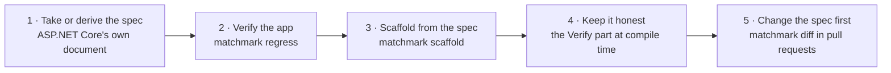

# Flip

Moving an application to spec-first: the spec becomes the source, and the application's HTTP layer is derived from it
and checked against it (decisions Q8, Q14, Q21). A new application starts at step 3.

## 1. Take or derive the spec

| Source | How | Status |
|:--|:--|:--|
| A spec the team already has | Used as it is, after `matchmark audit`. | **Built** |
| ASP.NET Core's own document | The application serves `/openapi/v1.json` (`Microsoft.AspNetCore.OpenApi`); `matchmark derive <url or file> [--output spec.yaml]` makes it the starting spec: every operation gets an `operationId` (from its method and path, unique, where an endpoint has no `.WithName`), and what to review is listed: bodies with no documented 400, single-resource reads with no 404, responses with no example, a server URL that's only where the document was served, ASP.NET Core's default version, and what `matchmark audit` finds. | **Built** (`SpecDeriveTests`; the Pet Store passes the suite of the spec derived from its own document) |
| Recorded traffic | For applications that aren't ASP.NET Core: `matchmark derive --har <recording.har>` (an HTTP Archive, as browsers and proxies export it). Paths are templated where a segment is an id (`/pets/7` is `/pets/{petId}`), and a refused request in that place keeps the template. Schemas are inferred from every body seen: a field every sample has is required, one sometimes left out may be null, formats (uuid, date-time, date) are recognised, a request field's few repeated values are an enum, and a field whose values always bring their own fields is a discriminated union. Request bodies come from calls that succeeded; each status seen is an outcome. The review lists every guess. | **Built** (`TrafficDeriveTests`; the Pet Store passes the suite of the spec inferred from its own suite's traffic, the union of cat and dog details found) |

A derived spec records accidents as well as decisions. Review it, and fix what it says in the spec before going on.

## 2. Verify the application against it

`matchmark regress <spec> <url>` against the running application ([command line](cli.md#regress)). Failures here are
either bugs in the application or wrong statements in the spec; each is fixed in one or the other before the flip.
**Built.**

## 3. Scaffold from the spec

`matchmark scaffold <spec> <dir>` writes ordinary ASP.NET controllers or Minimal API endpoints, and a reference
implementation that answers with the spec's examples. The contract (types, outcome unions, handler interfaces) stays
generated (`MatchmarkParts="Contract"`). The existing handler bodies move into the scaffolded handlers one at a time.
**Built.**

## 4. Keep it honest

With the `Verify` part, the generator compares hand-written controllers and Map calls with the spec at compile time
([diagnostics](diagnostics.md#verifying-hand-written-endpoints) `MM010` to `MM023`), and the round-trip check proves the
running service describes itself exactly as the spec does. **Built.**

## 5. Change the spec first

From here a change starts in the spec, in a reviewed pull request. The compiler shows every handler and consumer it
reaches, and `matchmark diff` grades it ([command line](cli.md#diff)). **Built**, and so is judging it by what consumers do:
`--observed` takes the calls consumers made (a session's `GET /__fake/sessions/{id}/calls`, or any array of
`{operationId, status}`), and a breaking change no recorded call reached (an operation nobody called, or a change to a
response status nobody received) is listed as unobserved and doesn't fail the run (`DiffTests`). Collecting the calls
from every session in CI and passing them to `diff` in pull requests is the team's pipeline, not Matchmark's.

## Events

AsyncAPI follows the same path (Q21):

| Step | For events | Status |
|:--|:--|:--|
| Verify | A consumer is held to its suite through a broker bridge; a producer's messages are checked. | **Built** for AsyncAPI 3 |
| Generate | Typed messages, a receiver interface and a sender. | **Built** |
| Adapters | A transport adapter per broker, behind the generated interfaces. The first is whichever broker the trial service uses. | **Planned** |

## The trial

The whole spine (verify, sessions, flip) is tried end to end on one real ASP.NET Core service with a frontend (Q15). Until
one is chosen, the Pet Store sample stands in (Q50); it has no frontend, so its sessions step is exercised by tests
(`SessionCopyTests`). **Planned.**
