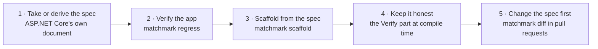

# Flip

Moving an application to spec-first: the spec becomes the source, and the application's HTTP layer is derived from it
and checked against it (decisions Q8, Q14, Q21). A new application starts at step 3.

## 1. Take or derive the spec

| Source | How | Status |
|:--|:--|:--|
| A spec the team already has | Used as it is, after `matchmark audit`. | **Built** |
| ASP.NET Core's own document | The application serves `/openapi/v1.json` (`Microsoft.AspNetCore.OpenApi`); that document is the starting spec. The round-trip check already reads it. | **Partial**: read, not yet turned into a starting spec with a command |
| Recorded traffic | For applications that aren't ASP.NET Core. | **Planned**, later (Q14) |

A derived spec records accidents as well as decisions. Review it, and fix what it says in the spec before going on.

## 2. Verify the application against it

`matchmark regress <spec> <url>` against the running application ([command line](cli.md#regress)). Failures here are
either bugs in the application or wrong statements in the spec; each is fixed in one or the other before the flip.
**Built.**

## 3. Scaffold from the spec

`matchmark scaffold <spec> <dir>` writes ordinary ASP.NET controllers or Minimal API endpoints, and a reference
implementation that answers with the spec's examples. The contract (types, outcome unions, handler interfaces) stays
generated (`MatchmarkParts="Contract"`). The existing handler bodies move into the scaffolded handlers one at a time.
**Built.**

## 4. Keep it honest

With the `Verify` part, the generator compares hand-written controllers and Map calls with the spec at compile time
([diagnostics](diagnostics.md#verifying-hand-written-endpoints) `MM010` to `MM023`), and the round-trip check proves the
running service describes itself exactly as the spec does. **Built.**

## 5. Change the spec first

From here a change starts in the spec, in a reviewed pull request. The compiler shows every handler and consumer it
reaches, and `matchmark diff` grades it ([command line](cli.md#diff)). **Built**; running `diff` in pull requests fed with
the outcomes consumers actually observed is **Planned** (step 5).

## Events

AsyncAPI follows the same path (Q21):

| Step | For events | Status |
|:--|:--|:--|
| Verify | A consumer is held to its suite through a broker bridge; a producer's messages are checked. | **Built** for AsyncAPI 3 |
| Generate | Typed messages, a receiver interface and a sender. | **Built** |
| Adapters | A transport adapter per broker, behind the generated interfaces. The first is whichever broker the trial service uses. | **Planned** |

## The trial

The whole spine (verify, sessions, flip) is tried end to end on one real ASP.NET Core service with a frontend (Q15).
**Planned:** the service isn't named yet ([question 3](../QUESTIONS.md)).
