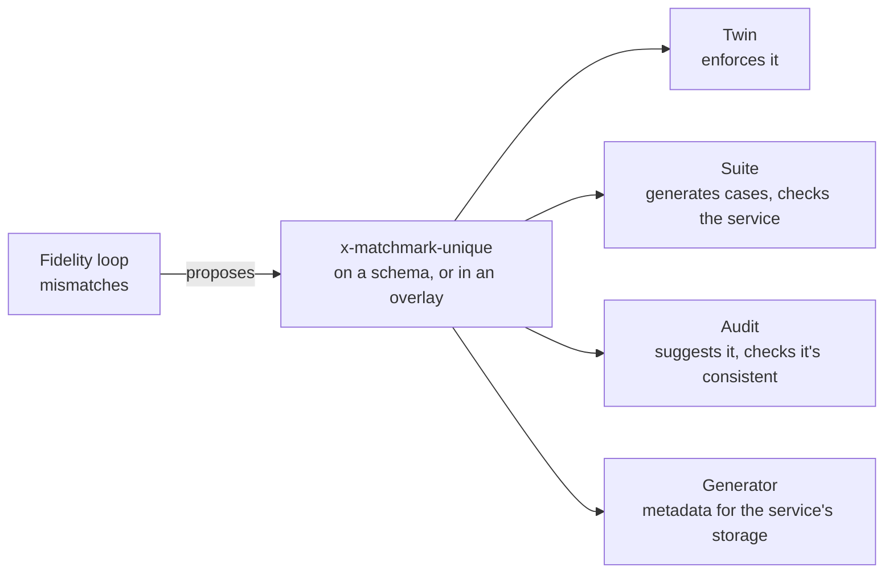

# Invariants across a collection

Decision Q44 ([decisions](../decisions.md#second-round)). **`unique` and `references` are Built**, end to end; the
other traits are **Planned**. This page specifies a fifth scope of invariant, the rules that hold across every resource in a collection,
and the vocabulary Matchmark reads for it.

## Why

Matchmark reads invariants in four scopes today ([extensions](extensions.md)):

| Scope | Example | Extension |
|:--|:--|:--|
| One payload | a booking ends after it starts | `x-matchmark-rules` (CEL) |
| One request's parameters | a room or a desk, not both | `x-dependencies` (IDL) |
| A request and its response | the created pet has the name sent | `x-matchmark-ensures` (Arazzo criteria) |
| Two readings of one resource | a version only goes up | `x-matchmark-transitions` (CEL) |

None can say *no two pets share a name*. That needs the whole collection, and it is most of what a twin gets wrong:
- the Pet Store twin's only gap was a unique name, written by hand as owned code;
- on the Ledger, a derived balance took held-out fidelity from 61.9% to 85.7%, and what remains looks like transfers
  conserving money and referring to accounts that exist.

**Behaviour as data, built once.** Each trait below is a declaration, read by one implementation in Matchmark, so no
team writes it again for their API. One declaration feeds five consumers:



**Where declarations stop.** If a behaviour is a property of data visible through the API, declare it. If it needs
knowledge the API doesn't expose (pricing, fraud rules, time-driven work, side effects, other APIs' state), write it as
the twin's owned code, or use a [service session](sessions.md#service-sessions). Each trait must earn its place by the
fidelity it adds across the corpus.

## The traits

| Trait | Extension | Says | Twin | Suite |
|:--|:--|:--|:--|:--|
| [unique](#unique) (**Built**) | `x-matchmark-unique` | no two resources share these values | enforces | duplicates, case variants, renames into a taken value |
| [references](#references) (**Built**) | `x-matchmark-references` | this value names a resource that exists | enforces, and on delete restricts, cascades or clears | references to nothing; deleting what's referenced |
| [derived](#derived) | `x-matchmark-derived` | this value is computed from the request or the resource | computes it | checks each response's value |
| [conserved](#conserved) | `x-matchmark-conserved` | a total over the collection doesn't change | checks only; the change itself is owned code | reads the total before and after |
| [scoped](#scoped) | `x-matchmark-scoped` | a resource belongs to the principal that created it | filters by token | a second principal can't see or change it |
| [limit](#limit) | `x-matchmark-limit` | at most n resources per scope | enforces | the n + 1th create |
| [order](#order) | `x-matchmark-order` | a list is sorted this way | sorts | checks order, across pages too |

Rules that span a collection but fit no trait are not given a general escape hatch yet (a CEL rule over the whole
collection was considered: it can be checked, but neither the twin nor the suite can act on it). Immutable fields need
no trait: `x-matchmark-transitions` already says `self.sku == oldSelf.sku`.

## Common rules

These apply to every trait.

**Placement.** A trait goes on the component schema of the resource (`components.schemas.Pet`), except `order`, which
goes on a list operation. An overlay can add it, so a spec you don't own needn't change:

```yaml
overlay: 1.2.0
info: { title: Pet Store behaviour, version: 1.0.0 }
actions:
  - target: $.components.schemas.Pet
    update:
      x-matchmark-unique:
        - fields: [name]
          ignoreCase: true
```

**The collection.** A schema's collection is the path whose `POST` (or `PUT` to an item path) creates it and whose `GET`
lists it, as the twin infers today: `/pets` and `/pets/{petId}`. A nested path (`/owners/{ownerId}/pets`) is one
collection per parent; `scope: parent` limits a trait to it.

**Fields** are JSON property names as the spec writes them. A nested field is a dotted path (`details.kind`). An unknown
field is diagnostic `MM027`.

**The status a violation answers with** is taken from the operation that breaks the trait, never invented:

| Trait | Statuses tried, in order |
|:--|:--|
| unique, limit | 409, 422, 400 |
| references (an unknown target) | 422, 404, 400 |
| references (deleting what's still referenced, `restrict`) | 409, 422 |
| scoped (another principal's resource) | 404, 403 |

A trait may name its status (`status: 400`), which wins: the Ledger documents 422 for a reused Idempotency-Key, but answers
an unknown account with 400, so its references say so. Otherwise the first status the operation documents is used. When
it documents none of them, the trait still holds in the twin (answered with the first status in the list, as a problem),
and the generator reports the gap (`MM028`), unless the declaration names its status.

**The problem body** follows the documented response's schema; for a validation problem, the error is keyed by the
field: `{"errors": {"name": ["Must be unique: another pet has it."]}}`.

**What the generator does.** The generated server can't enforce a collection rule: it has no storage, and a check before
writing races with another request. Enforcement belongs to the service's storage (a unique index, a foreign key), and
the suite proves the service has it. The generator does emit the declarations as metadata (`{Api}Invariants`, below), so
a service can apply them to its storage from one source.

## unique

**Built.** The Pet Store and the Shelter declare their unique names. What it showed on the Pet Store: the twin from the
spec alone, with the declaration, scores 93.2% against the real service (96 of 103 steps), exactly what the hand-written
owned code scored on the spec without it, and the suite catches a twin of the bare spec on all three cases
(`TwinTests`).

```yaml
x-matchmark-unique:
  - fields: [name]          # one key; two or more fields make a compound key
    ignoreCase: false       # compare strings case-insensitively (ordinal, invariant culture)
    scope: collection       # collection (default), or parent for a nested collection
    nulls: distinct         # distinct (default, as SQL unique indexes do), or equal
```

A list, so a schema can have several keys (`[sku]` and `[name, category]`). `scope: parent` and `nulls` are read; the
twin compares within the collection it holds, which for a nested path is one parent's.

**Semantics.** For every two resources in the scope, the values of the key's fields differ. Under `nulls: distinct`, a
resource with any key field null or absent doesn't collide. Under `ignoreCase`, strings are compared after
`ToUpperInvariant`. Writes that can break it: a create (`POST` to the collection), a `PUT` that creates or replaces, a
`PATCH` that changes a key field. Changing a resource to its own current value never collides.

**Twin.** Before storing, finds any other resource in scope with the same key and answers the status above. Replaces
owned code such as the Pet Store's `Taken` behaviour in `TwinTests`.

**Suite.** Generated cases, each expecting the violation status:

| Case | Request |
|:--|:--|
| `{op}: unique {fields} taken` | create with a key another case already created |
| `{op}: unique {fields} taken, other case` | the same, in a different case, when `ignoreCase` |
| `{op}: unique {fields} renamed into` | `PUT` or `PATCH` a second resource to the first's key |

Each runs once per create operation, after its first successful valid case, with a fresh `Idempotency-Key` so a repeat
isn't a replay. A fresh key succeeding is already every valid case. Checked as `UniqueEnforced`: accepted is a failure,
refused with another status than the documented one a warning. The checks need a target that keeps state, so they run
only with workflows on (a stateless fake runs with them off).

**Audit.** Rule `unique-declared`: a create (a `POST` with a 201) that documents 409, whose created schema declares no
`x-matchmark-unique`, gets a note. Not when the create takes an `Idempotency-Key`: its 409 is the draft's "still being
processed" (the Orders sample).

**Fidelity loop.** `FidelityLoop.ProposeUnique(twin, fidelity)`: a mismatch where the twin answered 2xx and the real API
409, on a create whose body repeats a string an earlier create to the same collection sent, is proposed as a `unique`
declaration on that field (ignoring case when only the case differed), for a person to review.

**Generator.** The `Contract` part's `PetStoreInvariants.Unique` lists the keys
(`new PetStoreUniqueKey("Pet", new[] { "name" }, true)`), for a service to apply to its storage (Q46). When the project
also references EF Core, the `Server` part adds `modelBuilder.ApplyPetStoreUnique<PetRecord>("Pet", map)`: a unique
index per key, where `map` names the entity property for a JSON field (default: the field in Pascal case), since the
stored entity and the API model are different types. Ignoring case is the store's (the Pet Store's `NOCASE` column).
The helper is generated into the service, which already references EF Core, so Matchmark.Conformance needn't.

## references

**Built.** The Ledger declares a transfer's `from` and `to` (its overlay), and its real server passes the checks;
`TraitTests` shows each `onDelete` in the twin, and the suite catching a twin without the declaration.

```yaml
x-matchmark-references:
  ownerId:
    target: /owners/{ownerId}   # the item path of the collection referred to
    onDelete: restrict          # restrict (default), cascade, clear, or none
    required: true              # a null or absent value is allowed when false
    status: 400                 # optional: the status a reference to nothing answers with
```

Keyed by field. `target` is the item path; the referred resource is the one whose id is the field's value.

**Semantics.** On a write, the referred resource must exist (in the same parent scope for nested collections). When the
referred resource is deleted: `restrict` refuses the delete while anything refers to it; `cascade` deletes what refers to
it; `clear` sets the field to null (the field must be nullable, else `MM027`); `none` leaves dangling references, which
are then allowed.

**Twin.** Checks the target on writes; applies `onDelete` on deletes.

**Suite.** After the first successful create of a referring resource:
- `{op}: references {field} to nothing`: the same create with the field set to an id of its type that a read of the
  target confirms is missing (404), expecting the unknown-target status;
- `{op}: references {field} still referring`, for `restrict` when the target can be deleted: a fresh target and a fresh
  resource referring to it are created, then the target is deleted, which must be refused.

Checked as `ReferenceHolds`: an accepted reference to nothing, or an accepted restricted delete, is a failure. Both need
a target that keeps state, so they run with workflows on. Checking `cascade` and `clear` from the suite (reading the
referring resource after the delete) is **Planned**; the twin applies them.

**Generator.** `{Api}Invariants.References` lists them (`new LedgerReference("Transfer", "from", "/accounts/{accountId}",
"restrict")`), for a foreign key. MM027 reports an unknown field, a target path the spec doesn't have, an unknown
`onDelete`, and `clear` on a field that can't be null. A foreign-key helper for EF Core is **Planned**: it needs the
entity's navigation, which only the service knows.

## derived

```yaml
x-matchmark-derived:
  balance:
    on: create        # create, update, or always
    value: request.opening
  total:
    on: always
    value: self.lines.map(l, l.quantity * l.unitPrice).sum()
```

**Semantics.** The field's value is the CEL expression, evaluated over `request` (the request body), `self` (the
resource as stored, before the field is set) and `oldSelf` (on update, the resource before the change). `create` sets it
once; `update` sets it on each change; `always` holds whenever the resource is read. A derived field should be
`readOnly`; if not, `MM027`.

**Twin.** Computes the field as it stores the resource. Replaces owned code such as the Ledger's opening-to-balance
behaviour, which the independent agent wrote.

**Suite.** Checks each success response holding the resource: the field equals the expression. Checked as
`DerivedHolds`.

## conserved

```yaml
x-matchmark-conserved:
  - total: balance                       # a numeric field, decimal strings included
    except: [openAccount, closeAccount]  # operations that may change it
```

**Semantics.** Over the whole collection, the sum of the field is the same before and after every successful operation
not listed in `except`. A ledger's transfers conserve money; opening an account doesn't.

**Twin.** Checks only. Which resources change, and by how much, is the operation's business logic, so it stays owned
code; the twin refuses (500, naming the trait) an owned behaviour that breaks the total, so a wrong behaviour is caught
in the twin's own tests.

**Suite.** In workflows, lists the collection before and after each such step and compares the totals. Checked as
`TotalConserved`. A paged list is walked whole.

## scoped

```yaml
x-matchmark-scoped:
  by: principal     # the security principal that created the resource
  visible: owner    # owner (default): others can't list, read or change it
```

**Semantics.** A resource belongs to the principal whose credential created it. Others don't see it in lists, and get
the scoped status when they read, change or delete it.

**Twin.** Records the creating token and filters by it. In [sessions](sessions.md), each session's token is a principal;
a session mints a second principal for a test with `POST /__fake/sessions/{id}/principals` (Q47).

**Suite.** Needs two credentials (`RegressionOptions.Principals`, `matchmark regress --principal <header>` twice, Q47). Creates
as the first, then reads, lists, changes and deletes as the second. Checked as `ScopeHolds`. Without two principals, the
cases are a gap, not a pass.

## limit

```yaml
x-matchmark-limit:
  max: 5
  scope: parent      # collection, parent, or principal
```

**Semantics.** At most `max` resources in the scope. The `max + 1`th create answers the violation status.

**Twin.** Enforces. **Suite.** Creates up to the limit, then once more: `{op}: limit {max} reached`. Checked as
`LimitEnforced`. A limit above 50 isn't exercised (the cases would be slow); the audit says so.

## order

```yaml
# on a list operation, e.g. paths./pets.get
x-matchmark-order:
  by: [createdAt desc, id]   # fields, each asc (default) or desc; ties broken by the next
```

**Semantics.** The list is sorted by the fields in order. A sort parameter the operation takes (`?sort=name`) overrides
it, when the parameter's values are field names.

**Twin.** Sorts lists; today it lists in insertion order. **Suite.** Checks every
list response, and across pages that each page continues the order. Checked as `ListOrdered`.

## Diagnostics

| Id | Severity | When |
|:--|:--|:--|
| MM027 (**Built** for unique) | Warning | A trait names an unknown field, a `target` path the spec doesn't have, `clear` on a non-nullable field, a derived field that isn't `readOnly`, or a `conserved` total that isn't numeric. The trait is ignored. |
| MM028 (**Built** for unique) | Info | An operation that can break a trait documents none of its statuses. The twin answers the first status in the list. |

## Order of work

| Trait | Order | Why |
|:--|:--|:--|
| unique | 1 | the commonest; the Pet Store's owned code is the proof |
| references | 2 | the Ledger's transfers, and most APIs with child resources |
| derived, order | 3 | small, and each removes a known mismatch |
| conserved, limit | 4 | |
| scoped | 5 | needs a second principal in the suite and in sessions |

Each is done when the twin enforces it with no owned code, the suite catches a service that breaks it (an injected
fault, as every check is proven), the audit suggests it, and the fidelity of the corpus samples that need it doesn't
fall.
