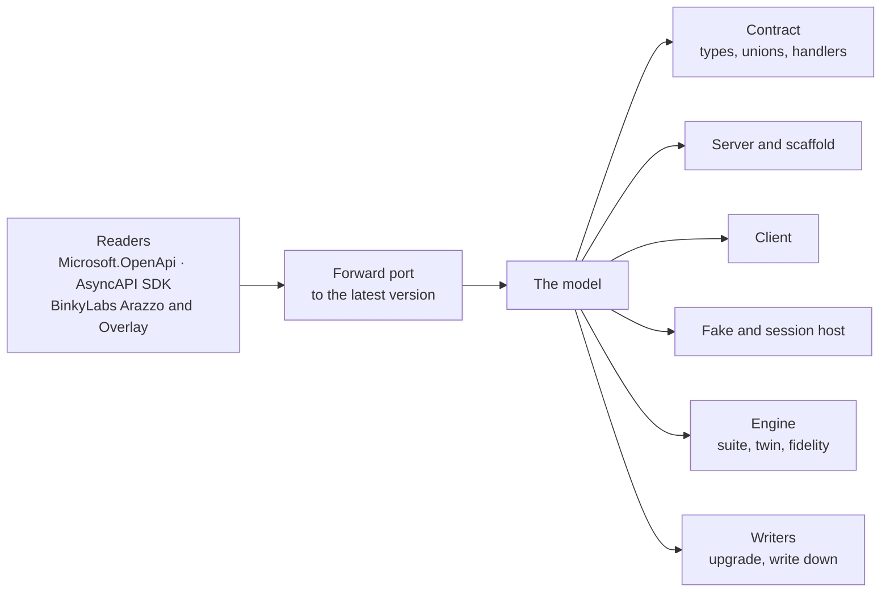

# The model

**Partial: roadmap step 2** (decisions Q10, Q24). The design the generator moves onto before any new output is added.
[Status](#status) says what's moved.

## Why

Today one class, `Emitter`, reads Microsoft.OpenApi's document and writes every output: 3,979 lines, plus 652 in
`EmitterScaffold`. Each output decides again what an operation's outcomes are, how a schema maps to a type, and what is
unsupported. The engine (`Matchmark.Testing`) makes the same decisions a third time over JSON. Every new output
(hosts, versions, adapters) multiplies that, and the copies drift.

The model makes each decision once. Every output, the generator's and the engine's, is a function of it.

## What it holds

The model holds the latest version of each format (OpenAPI 3.2, AsyncAPI 3.1, Arazzo 1.1, Overlay 1.2). Older inputs
are forward-ported before they reach it.

| Element | Holds | Today it is |
|:--|:--|:--|
| **Api** | name, version, servers, security schemes, operations, channels, schemas, workflows | spread across `Emitter` fields |
| **Operation** | id, method (including `QUERY` and additional operations), path, parameters, body, outcomes, traits, deprecation, links, callbacks | `Emitter.Operation` |
| **Parameter** | name, location (path, query, querystring, header, cookie), schema, required, style | `Emitter.Param` |
| **Body** | media type (JSON, form, text, streamed items), schema, required | `Emitter.Body` |
| **Outcome** | status or range (`4XX`, `default`), case name, body type, headers, streamed item schema, whether it's a success, a redirect or a validation problem | `Emitter.Response` |
| **Schema** | a resolved type: object, union (with or without discriminator), alias, array, map, enum, scalar with format, any JSON; constraints; invariants | Microsoft.OpenApi schemas, interpreted in each output |
| **Trait** | behaviour from standard HTTP or extensions: idempotency key, conditional (If-Match), paging, long-running (202), rate limit, deprecation, rules, transitions, dependencies, postconditions, relations | checks in `Matchmark.Testing`, attributes in `Emitter` |
| **Channel** | an AsyncAPI channel: address, parameters, messages, and send or receive operations | read as webhooks today |
| **Workflow** | an Arazzo workflow: steps (operation or message), criteria, outputs, actions | `ArazzoDocument`, over JSON |
| **Unsupported** | anything read but not representable yet, with where and why | `MM002` diagnostics as they're found |

## Rules

- **Decided once.** A naming, typing or support decision is made in the model and nowhere else.
- **Tested directly.** The model has tests of its own, built from small specs, independent of any output.
- **Incremental.** Parsing is its own incremental generator step, and output is per tag, so editing one tag's
  operations or a controller doesn't re-parse or regenerate the rest.
- **No behaviour change on the move.** Every existing test stays green while outputs move onto the model one at a time.

## Status

| Slice | State |
|:--|:--|
| Split by output | **Built.** `Emitter.cs` (4,334 lines) is a partial class across a file per output, cut along its own section markers: `Emitter.Schemas`, `.Validation`, `.Operations` (the operation model and how it's read), `.Responses`, `.Handlers`, `.Client`, `.Samples`, `.Fake`, `.Endpoints`, `.OpenApi`, `.Invariants`, `.Scaffold`, `.Model`, with `CodeWriter` on its own. The largest is 863 lines. No output changed. |
| A read-only view, tested directly | **Built.** `ApiModel.Read(spec)` gives each operation's id, method, path, tag, typed parameters and where they bind from, body (type, media type, required, validated) and outcomes (status, type, success, validation problem), and the diagnostics; `ApiModelTests` pins them from small specs. Writing it found one decision made in only one place: whether a body is required was recorded for text bodies alone, and is now recorded for every body. |
| The engine on the model | Planned: `Matchmark.Testing` still reads the normalised JSON itself (question 1 in [QUESTIONS](../QUESTIONS.md)). |
| Outputs as functions of the model | Planned: each output still reads the emitter's operation objects and Microsoft.OpenApi's schemas; schemas, traits, channels and workflows aren't in the model yet. |
| Incremental by tag | Planned, on [question 4](../QUESTIONS.md): parsing as its own incremental step with an equatable model, and output per tag, which splits the generated registration by tag. |

## Done when

An edit to one tag regenerates only that tag, the model has its own tests, and no source file is near 4,000 lines.
