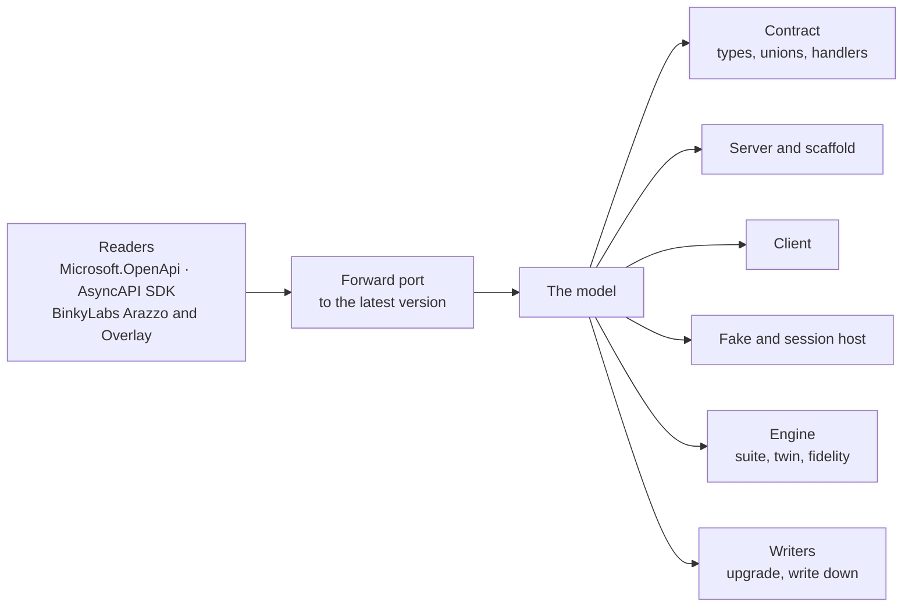

# The model

**Partial: roadmap step 2** (decisions Q10, Q24). The design the generator moves onto before any new output is added.
[Status](#status) says what's moved.

## Why

Today one class, `Emitter`, reads Microsoft.OpenApi's document and writes every output: 3,979 lines, plus 652 in
`EmitterScaffold`. Each output decides again what an operation's outcomes are, how a schema maps to a type, and what is
unsupported. The engine (`Matchmark.Testing`) makes the same decisions a third time over JSON. Every new output
(hosts, versions, adapters) multiplies that, and the copies drift.

The model makes each decision once. Every output, the generator's and the engine's, is a function of it.



## What it holds

The model holds the latest version of each format (OpenAPI 3.2, AsyncAPI 3.1, Arazzo 1.1, Overlay 1.2). Older inputs
are forward-ported before they reach it.

| Element | Holds | Today it is |
|:--|:--|:--|
| **Api** | name, version, servers, security schemes, operations, channels, schemas, workflows | spread across `Emitter` fields |
| **Operation** | id, method (including `QUERY` and additional operations), path, parameters, body, outcomes, traits, deprecation, links, callbacks | `Emitter.Operation` |
| **Parameter** | name, location (path, query, querystring, header, cookie), schema, required, style | `Emitter.Param` |
| **Body** | media type (JSON, form, text, streamed items), schema, required | `Emitter.Body` |
| **Outcome** | status or range (`4XX`, `default`), case name, body type, headers, streamed item schema, whether it's a success, a redirect or a validation problem | `Emitter.Response` |
| **Schema** | a resolved type: object, union (with or without discriminator), alias, array, map, enum, scalar with format, any JSON; constraints; invariants | Microsoft.OpenApi schemas, interpreted in each output |
| **Trait** | behaviour from standard HTTP or extensions: idempotency key, conditional (If-Match), paging, long-running (202), rate limit, deprecation, rules, transitions, dependencies, postconditions, relations | checks in `Matchmark.Testing`, attributes in `Emitter` |
| **Channel** | an AsyncAPI channel: address, parameters, messages, and send or receive operations | read as webhooks today |
| **Workflow** | an Arazzo workflow: steps (operation or message), criteria, outputs, actions | `ArazzoDocument`, over JSON |
| **Unsupported** | anything read but not representable yet, with where and why | `MM002` diagnostics as they're found |

## Its shape in the pipeline

**Planned.** This is what Parquet.SourceGenerator shows for a generator's model in Roslyn's incremental pipeline. Its
models are `sealed record`s, its collections are `EquatableArray<T>`, and its diagnostics are data
(`DiagnosticInfo(descriptor, position, arguments)`). No `ISymbol`, `SyntaxNode` or `Location` is held in them. Roslyn
compares each step's output with the last run, and a step can be skipped only when those outputs compare equal by value.

Today the spec moves through the pipeline as text. Every output step parses it again with Microsoft.OpenApi, and the
emitter's `Operation` and `Param` objects hold `IOpenApiSchema`, which can't be compared by value. The per-tag slices are
JSON text, so an edit to a component touches every slice, even a tag that doesn't use that component.

The shape the model takes:

```text
specs (text, path, metadata)
  → Parse     ApiShape          equatable; the only step that sees Microsoft.OpenApi
  → Partition ComponentsShape   the schemas, shared responses and bodies, each named once
              TagShape × n      one per tag: its operations, and the component names they use
  → Emit      pure functions of a shape: ComponentsShape → models, validation, invariants;
              TagShape (+ the component names it uses) → endpoints, handlers, client, fake
```

| Shape | Holds |
|:--|:--|
| `ApiShape` | name, namespace, parts, version, servers, security; `ComponentsShape`; `EquatableArray<TagShape>`; `EquatableArray<DiagnosticInfo>` |
| `OperationShape` | id, method, path, tag, `EquatableArray<ParameterShape>`, `BodyShape?`, `EquatableArray<OutcomeShape>`, `EquatableArray<TraitShape>`, deprecation |
| `ParameterShape` | the wire name; the C# identifier, decided here and nowhere else; where it binds from; its type; required; style |
| `OutcomeShape` | status or range, case name, body type name, headers, success, redirect or validation problem |
| `TypeShape` | a resolved type: object (`EquatableArray<MemberShape>`), union, alias, array, map, enum, scalar with format; `EquatableArray<ConstraintShape>` |
| `MemberShape` | JSON name, C# name, type name, required, nullable, read or write only |
| `ConstraintShape` | keyword and value as text (`maxLength`, `50`): equatable, and written out unchanged |
| `TraitShape` | kind and arguments: idempotency, conditional, paging, long-running, invariants, rules |
| `DiagnosticInfo` | descriptor id, arguments, and a JSON pointer into the spec, turned into a `Location` only when reported |

What this buys:

- **Names decided once.** `ParameterShape.Identifier` is decided once, and so are type, case and member names. Today
  each output re-derives them from the spec, which is how a query parameter named `body` came to clash with the request
  body: `RandomSpecTests` found it. Names now come from the model's one function for each.
- **Reuse that follows the spec's structure.** An edit to one operation changes one `TagShape`. An edit to a component
  changes the `ComponentsShape` and only the tags whose component names include it. A comment or reordering changes no
  shape, so nothing re-emits.
- **Outputs that can be tested without Roslyn.** An emitter given a hand-built `TagShape` can be tested in a
  millisecond, and a change to what is decided shows up in `{sample}.model.json` before it shows up in any generated file.
- **The engine on the same model.** `Matchmark.Testing` can read the same shapes, serialised, instead of the normalised
  JSON (question 1).

What it avoids: one parser of several thousand lines. Parquet.SourceGenerator's parser and its emitter are 2,400 lines
each. Here the parse is split by element (operation, parameter, outcome, type, trait), as the emitter is split by
output today, and each piece is tested from small specs.

The move keeps the rule below: one output at a time, every test green. The endpoints go first, since they're already
per tag, then the handlers and the client, then the components. `IncrementalityTests` gains a case at each step: an
edit to a component used by one tag re-emits that tag alone.

## Rules

- **Decided once.** A naming, typing or support decision is made in the model and nowhere else.
- **Tested directly.** The model has tests of its own, built from small specs, independent of any output.
- **Incremental.** Parsing is its own incremental generator step, and output is per tag, so editing one tag's
  operations or a controller doesn't re-parse or regenerate the rest.
- **No behaviour change on the move.** Every existing test stays green while outputs move onto the model one at a time.

## Status

| Slice | State |
|:--|:--|
| Split by output | **Built.** `Emitter.cs` (4,334 lines) is a partial class across a file per output, cut along its own section markers: `Emitter.Schemas`, `.Validation`, `.Operations` (the operation model and how it's read), `.Responses`, `.Handlers`, `.Client`, `.Samples`, `.Fake`, `.Endpoints`, `.OpenApi`, `.Invariants`, `.Scaffold`, `.Model`, with `CodeWriter` on its own. The largest is 863 lines. No output changed. |
| A read-only view, tested directly | **Built.** `ApiModel.Read(spec)` gives each operation's id, method, path, tag, typed parameters and where they bind from, body (type, media type, required, validated) and outcomes (status, type, success, validation problem), and the diagnostics; `ApiModelTests` pins them from small specs. Writing it found one decision made in only one place: whether a body is required was recorded for text bodies alone, and is now recorded for every body. |
| The engine on the model | Planned: `Matchmark.Testing` still reads the normalised JSON itself (question 1 in [QUESTIONS](../QUESTIONS.md)). |
| Outputs as functions of the model | Planned ([its shape](#its-shape-in-the-pipeline)): each output still reads the emitter's operation objects and Microsoft.OpenApi's schemas; schemas, traits, channels and workflows aren't in the model yet. |
| Names decided once | **Built** for shared bodies: an inline body of a shared response or request body (`components/responses`, `components/requestBodies`) is named after the component (`ServiceUnavailableBody`), not after whichever operation is read first, so the name is the same in the whole spec and in any tag's slice. |
| Incremental by tag | **Built for endpoints:** each tag's slice of the spec (its operations, every component, overlays applied) is an equatable input, and its endpoints are generated from it alone (`Map{Api}{Tag}`, in `{Api}.Endpoints.{Tag}.g.cs`), so Roslyn reuses the tags an edit didn't touch (`IncrementalityTests`, on the named steps). The other per-operation outputs are on [question 4](../QUESTIONS.md). |

## Done when

An edit to one tag regenerates only that tag, the model has its own tests, and no source file is near 4,000 lines.
