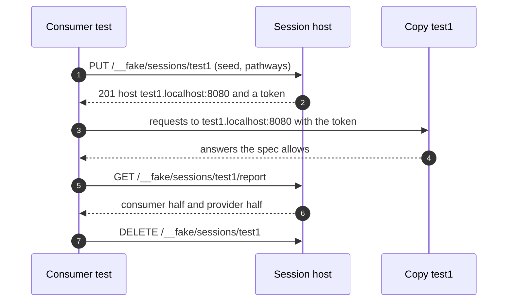

# Hosted sessions

A C# server hosts a copy of the API for each test session. Any test, in any language, reaches its own copy over HTTP,
so frontend, mobile and service tests can run in parallel against the spec without a real backend, and without seeing
each other's state (decisions Q34 to Q43).

This page is the protocol. What exists today is marked **Built**; the rest is **Planned** for roadmap step 4, and is
written precisely enough to build against.



## What a copy is

Each session's copy is one implementation of the generated handler interface (`I{Api}Handlers`), chosen by the host
(Q43):

| Copy | Behaviour | Status |
|:--|:--|:--|
| Twin | State inferred from the spec's paths, seeded per session: what is created can be read, listed, changed and deleted. | **Built** as `SpecTwin`; not yet per session. |
| Scripted fake | Answers scripted per operation (`Given`) and expected calls (`Should`). Only documented outcomes can be scripted. | **Built** as the generated fake. |
| Twin with a script on top | The default (Q37): the twin answers unless a script says otherwise, and expectations are checked against every call. | **Planned** |
| The real service | For a session that should hit the real implementation, in-process. | **Planned** |

Every copy checks every request as the spec says and answers only documented outcomes, because all of them sit behind
the same generated endpoints.

## Routing

| Route | Example | Status |
|:--|:--|:--|
| **By host** (Q35) | `http://test1.localhost:8080/pets` | **Planned** |
| By header | `X-Matchmark-Session: test1` on any host | **Planned** ([question 6](../QUESTIONS.md)) |
| By path prefix | `http://localhost:8080/sessions/test1/pets` | **Built**; kept until host routing is proven |

**Host routing** reads the `Host` header, not DNS. The first label of the host is the session id when the host is
`{id}.localhost` or `{id}.{configured domain}`. Browsers resolve `*.localhost` to loopback; a client whose resolver
doesn't can connect to `localhost` and send `Host: test1.localhost` itself. Paths stay exactly as the spec writes them,
so the application under test changes only its host.

A request whose host names no session gets a `404` problem: *There is no session 'test2'.* It never reaches an empty
copy.

## Starting a session

**Planned (Q36):** the consumer chooses the id.

```http
PUT /__fake/sessions/test1
Content-Type: application/json

{
  "seed": { "/pets": [ { "id": 1, "name": "Rex", "status": "available" } ] },
  "pathways": ["adopt-a-pet"],
  "scenario": null
}
```

| Field | Meaning |
|:--|:--|
| `seed` | Starting data for the twin, by collection path. Each item is checked against its schema. |
| `pathways` | The Arazzo workflow ids this consumer must cover, or `"all"`. Default: none. |
| `scenario` | Expected calls, in the scenario format the fake already reads ([CONCEPT.md](../CONCEPT.md#scenarios-expected-calls-in-order-or-not)). Optional. |

`201 Created` for a new session, `200 OK` when the id existed and was replaced: a rerun starts clean. The answer:

```json
{
  "id": "test1",
  "baseUrl": "http://test1.localhost:8080/",
  "token": { "scheme": "bearer", "header": "Authorization", "value": "Bearer mm_test1_4f9c…" }
}
```

Ids are 1 to 63 characters of lower-case letters, digits and hyphens, starting with a letter, so each is a valid host
label.

**Built today:** `POST /__fake/sessions` with an optional scenario creates a session with a server-chosen id and answers
`201` with `{ "id", "baseUrl": "/sessions/{id}/" }`.

## The session token

**Planned (Q41).** Starting a session stands in for logging in. The token is issued in the form the spec's security
scheme takes, so the application's real auth path is exercised:

| Spec's security scheme | Token sent as |
|:--|:--|
| `http` `bearer`, `oauth2`, `openIdConnect` | `Authorization: Bearer <token>` |
| `http` `basic` | `Authorization: Basic <base64 of test1:<token>>` |
| `apiKey` in a header, query or cookie | the named header, query parameter or cookie |
| none | no token; the host alone picks the copy ([question 5](../QUESTIONS.md)) |

On an operation the spec secures:
- no token, or one that isn't valid, is `401`, as the spec documents it;
- a valid token from **another** session is `401` with *This token belongs to session 'test2'*, so parallel tests
  can't cross-talk.

Operations the spec leaves unsecured (`security: []`) answer without a token, routed by host alone.

## Scripting and expectations

| Endpoint | Does | Status |
|:--|:--|:--|
| `PUT /__fake/{operationId}` | Scripts the default copy's next answers for an operation. | **Built** |
| `PUT /__fake/sessions/{id}/given/{operationId}` | Scripts a session's answers: `{ "status": 409, "body": {…}, "times": 1 }`. Only documented outcomes. | **Planned** |
| `GET /__fake/calls` | The default copy's calls. | **Built** |
| `GET /__fake/sessions/{id}/calls` | A session's calls, in order. | **Planned** |
| `DELETE /__fake/` | Resets the default copy. | **Built** |

## Pathways

**Planned (Q40).** Server engineers publish pathways as Arazzo workflows next to the spec: the journeys a consumer must
support. A session lists the pathways required of its consumer.

A pathway counts as **completed** in a session when the session's calls contain the workflow's steps in order, each with
its success criteria met. Other calls may come between steps. Coverage is reported per workflow, per step, and per
documented outcome reached.

## The report

**Planned (Q42).** `GET /__fake/sessions/{id}/report` answers whether the run is complete from both directions.

```json
{
  "session": "test1",
  "complete": false,
  "consumer": {
    "passed": false,
    "pathways": [
      { "workflowId": "adopt-a-pet", "completed": true },
      { "workflowId": "return-a-pet", "completed": false, "missing": ["confirm-return"] }
    ],
    "calls": { "total": 14, "invalid": 0, "unexpected": 1 },
    "outcomes": { "documented": 23, "reached": 11 }
  },
  "provider": {
    "passed": true,
    "source": "regress",
    "recordedAt": "2026-11-08T09:12:00Z",
    "pathways": [ { "workflowId": "adopt-a-pet", "passed": true }, { "workflowId": "return-a-pet", "passed": true } ]
  }
}
```

- **The consumer's half** passes when every required pathway was completed, no call was invalid, and none was
  unexpected by the session's scenario.
- **The provider's half** passes when the real service passes the same pathways with `matchmark regress` and the Arazzo
  file. It comes from the latest recorded run, with its date ([question 7](../QUESTIONS.md)).
- **`complete`** is true only when both halves pass.

**Built today:** `GET /__fake/sessions/{id}` verifies a session's scenario and answers what went differently.

## Ending a session

`DELETE /__fake/sessions/{id}`: `204` when it ended, `404` when there was none. **Built.** A session nobody ends is
removed after 30 minutes without a request ([question 4](../QUESTIONS.md)). **Planned.**

## Events

**Planned (Q39).** Each session has its own event channels, and every message is checked against its AsyncAPI message:

| Channel | Reached at |
|:--|:--|
| WebSocket | `ws://test1.localhost:8080/{channel address}` |
| Broker (Kafka, AMQP, MQTT) | the broker bridge, per session: `POST /__fake/sessions/test1/messages/{operationId}` to deliver, `GET …/messages/{operationId}?correlationId=…` to receive |

## For .NET tests

**Planned (Q38).** A helper per test framework starts the session, gives the test an `HttpClient` bound to its copy and
token, and asks for the report at teardown:

```csharp
await using var session = await MatchmarkSession.StartAsync(host, id: TestContext.CurrentContext.Test.Name,
    seed: new { pets = new[] { new { id = 1, name = "Rex" } } }, pathways: ["adopt-a-pet"]);
var pets = new PetStoreClient(session.Client);
// … the test …
(await session.ReportAsync()).Consumer.Passed.Should().BeTrue();
```

**Built today:** the fluent fake server (`server.Given.GetPet(petId: 7).Returns.NotFound()`,
`server.Should().HaveReceived.GetPet(petId: 7).Once()`), on a real port, typed from the spec.

## Hosting

**Built:** a project with `MatchmarkParts="Server,FakeServer"` gets `Use{Api}FakeHub()` (sessions at
`/sessions/{id}/`) and `Map{Api}FakeControl()` (the control API at `/__fake`).

**Planned:** `matchmark host <spec>` serves the session host from the spec alone ([command line](cli.md#host),
[question 8](../QUESTIONS.md)).
