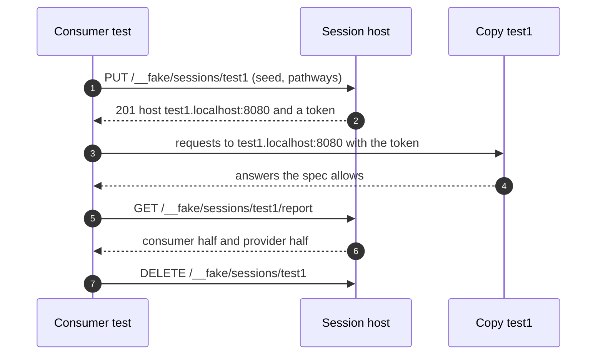
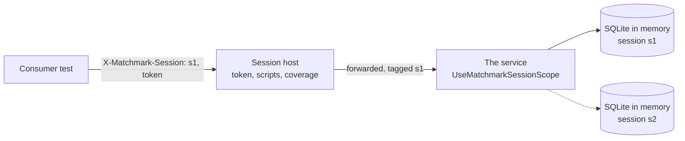

# Hosted sessions

A C# server hosts a copy of the API for each test session. Any test, in any language, reaches its own copy over HTTP,
so frontend, mobile and service tests can run in parallel against the spec without a real backend, and without seeing
each other's state (decisions Q34 to Q43).

This page is the protocol. What exists today is marked **Built**; the rest is **Planned** for roadmap step 4.
`matchmark host` serves it from a spec alone; `UseMatchmarkSessions` (Matchmark.Conformance) hosts it in any ASP.NET
Core app; `SessionHost` (Matchmark.Testing) is the logic. The Shelter sample (`samples/sessions`) and `SessionTests`
show it end to end.



## What a copy is

Each session's copy is one implementation of the generated handler interface (`I{Api}Handlers`), chosen by the host
(Q43):

| Copy | Behaviour | Status |
|:--|:--|:--|
| Twin (`"copy": "twin"`, the default) | The built-in store: state in memory, inferred from the spec's paths and seeded per session, so what is created can be read, listed, changed and deleted. Needs nothing but the spec. | **Built**, one per session |
| The real service (`"copy": "service"`) | The service itself, with data of the session's own: an ephemeral database per session, created and seeded when it starts and discarded when it ends. See [service sessions](#service-sessions). | **Built** (the Pet Store, on EF Core and SQLite) |
| Scripted fake | Answers scripted per operation (`Given`) and expected calls (`Should`). Only documented outcomes can be scripted. | **Built** as the generated fake, outside sessions |
| Twin with a script on top | The default (Q37): the twin answers unless a script says otherwise, and expectations are checked against every call. | **Built**: scripted answers, and expected calls as the session's `scenario` |

Every copy checks every request as the spec says and answers only documented outcomes, because all of them sit behind
the same generated endpoints.

## Routing

| Route | Example | Status |
|:--|:--|:--|
| **By host** (Q35) | `http://test1.localhost:8080/pets` | **Built** |
| By header | `X-Matchmark-Session: test1` on any host | **Built** (Q53); what the .NET helper uses |
| By path prefix | `http://localhost:8080/sessions/test1/pets` | **Built** |

**Host routing** reads the `Host` header, not DNS. The first label of the host is the session id when the host is
`{id}.localhost` or `{id}.{configured domain}`. Browsers resolve `*.localhost` to loopback; a client whose resolver
doesn't can connect to `localhost` and send `Host: test1.localhost` itself. Paths stay exactly as the spec writes them,
so the application under test changes only its host.

A request whose host names no session gets a `404` problem: *There is no session 'test2'.* It never reaches an empty
copy.

## Starting a session

**Built (Q36):** the consumer chooses the id.

```http
PUT /__fake/sessions/test1
Content-Type: application/json

{
  "seed": { "/pets": [ { "id": 1, "name": "Rex", "status": "available" } ] },
  "pathways": ["adopt-a-pet"],
  "scenario": null
}
```

| Field | Meaning |
|:--|:--|
| `copy` | `"twin"` (default) or `"service"`, when the host has a service ([service sessions](#service-sessions)). |
| `seed` | For a twin: starting data by collection path. For a service: whatever its start hook reads, such as a seed scenario's name (`"Demo"`). |
| `pathways` | The Arazzo workflow ids this consumer must cover, or `"all"`. Default: none. |
| `scenario` | Expected calls, in the scenario format the fake already reads ([CONCEPT.md](../CONCEPT.md#scenarios-expected-calls-in-order-or-not)), checked against every call. A step with a `body` scripts the answer; one without lets the copy answer, and its `status` must match. Each step's operation and status must be documented, or it's a `400`. How the calls kept to it is the report's `consumer.scenario`, and each failure is a reason. **Built** (`SessionTests`; `MatchmarkSession.StartAsync(…, scenario)`). |

`201 Created` for a new session, `200 OK` when the id existed and was replaced: a rerun starts clean. The answer:

```json
{
  "id": "test1",
  "baseUrl": "http://test1.localhost:8080/",
  "header": { "name": "X-Matchmark-Session", "value": "test1" },
  "token": { "in": "header", "name": "Authorization", "value": "Bearer mm_test1_9a85171a010ee032281da491" },
  "pathways": ["adopt-a-pet"]
}
```

When the host is reached by IP address, which has no subdomains, `baseUrl` uses `localhost`. `token` is `null` when the
spec declares no security scheme. An id that isn't a valid host label, or an unknown pathway, is a `400` problem.

Ids are 1 to 63 characters of lower-case letters, digits and hyphens, starting with a letter, so each is a valid host
label.

The generated fake server's hub (`MatchmarkParts="FakeServer"`) speaks the same protocol (**Built**): `PUT
/__fake/sessions/{id}` with `{"scenario": …}` starts a scripted fake under the consumer's id, answered with its
`baseUrl` and header, and it's reached by host or `X-Matchmark-Session` as well as by path prefix; a session named that
doesn't exist is a `404`, never the default fake. Its sessions stay scripted fakes, not twins: the generated fake
depends on Matchmark.Fakes alone. `POST /__fake/sessions` with a server-chosen id still works.

## The session token

**Built (Q41).** Starting a session stands in for logging in. The token is issued in the form the spec's security
scheme takes, so the application's real auth path is exercised:

| Spec's security scheme | Token sent as |
|:--|:--|
| `http` `bearer`, `oauth2`, `openIdConnect` | `Authorization: Bearer <token>` |
| `http` `basic` | `Authorization: Basic <base64 of test1:<token>>` |
| `apiKey` in a header, query or cookie | the named header, query parameter or cookie |
| none | no token; the host alone picks the copy (Q53) |

On an operation the spec secures:
- no token, or one that isn't valid, is `401`, as the spec documents it;
- a valid token from **another** session is `401` with *This token belongs to session 'test2'*, so parallel tests
  can't cross-talk.

Operations the spec leaves unsecured (`security: []`) answer without a token, routed by host alone.

**A second principal (Q47).** `POST /__fake/sessions/{id}/principals` mints another token in the same scheme, answered
`201 {"token": {"in", "name", "value"}}` (`MatchmarkSession.AddPrincipalAsync()` in .NET). The session accepts it as
well as its own; another session doesn't. The twin treats it as someone else, so a test can check a resource declared
[scoped](invariants.md#scoped) is kept from other users. With no security scheme there's nothing to mint: `409`.

## Scripting and expectations

| Endpoint | Does | Status |
|:--|:--|:--|
| `PUT /__fake/{operationId}` | Scripts the default copy's next answers for an operation. | **Built** |
| `PUT /__fake/sessions/{id}/given/{operationId}` | Scripts a session's answers: `{ "status": 409, "body": {…}, "times": 1 }`, or without `times` until replaced. Only documented outcomes; anything else is a `400` problem. | **Built** |
| `GET /__fake/calls` | The default copy's calls. | **Built** |
| `POST /__fake/sessions/{id}/principals` | Mints a second principal for the session ([the session token](#the-session-token)). | **Built** |
| `GET /__fake/sessions/{id}/calls` | A session's calls, in order: operation, method, path, status, and whether a script answered. | **Built** |
| `DELETE /__fake/` | Resets the default copy. | **Built** |

## Pathways

**Built (Q40).** Server engineers publish pathways as Arazzo workflows next to the spec: the journeys a consumer must
support. A session lists the pathways required of its consumer.

A pathway counts as **completed** in a session when the session's calls contain the workflow's steps in order, each with
its success criteria met. Other calls may come between steps. A criterion that refers to an earlier step's outputs
can't be judged from one call, so it counts as met by any 2xx. Coverage is reported per workflow, with the steps still
missing, and as documented outcomes reached.

Give the host its pathways with `--arazzo` (`matchmark host`), or as `new SessionHost(spec, [arazzo])`.

## The report

**Built (Q42).** `GET /__fake/sessions/{id}/report` answers whether the run is complete from both directions.

```json
{
  "session": "test1",
  "complete": false,
  "consumer": {
    "passed": false,
    "pathways": [
      { "workflowId": "adopt-a-pet", "completed": true },
      { "workflowId": "return-a-pet", "completed": false, "missing": ["confirm-return"] }
    ],
    "calls": 14,
    "invalid": 0,
    "documentedOutcomes": 23,
    "outcomesReached": 11
  },
  "provider": {
    "passed": true,
    "source": "regress",
    "recordedAt": "2026-11-08T09:12:00Z",
    "pathways": [ { "workflowId": "adopt-a-pet", "passed": true }, { "workflowId": "return-a-pet", "passed": true } ]
  },
  "reasons": [ "the consumer didn't complete return-a-pet: missing confirm-return" ]
}
```

- **The consumer's half** passes when every required pathway was completed and no call was invalid: a request the copy
  refused as the spec says (400, 415, 422), or a secured call without the session's token (401). Scripted answers
  don't count. Calls a scenario didn't expect will count too, once session scenarios are built.
- **The provider's half** passes when the real service passes the same pathways. It comes from a recorded run
  (Q53): `matchmark regress <spec> <url> --arazzo <pathways> --save provider.json` records
  each workflow's result, and `matchmark host … --provider provider.json` (or `SessionHost.Provider`) uses it. A
  pathway the record doesn't include counts as not passed.
- **`complete`** is true only when both halves pass. **`reasons`** says why not, one line each.

## Service sessions

**Built.** A session whose copy is the real service tests the actual handlers, storage and queries, where a twin only
infers CRUD from the spec. The Pet Store shows it on EF Core and SQLite (`SessionCopyTests`).



1. **The host forwards.** `new SessionHost(spec, pathways) { Service = new ServiceCopy(client, start, end) }`. For a
   service session, the host checks the token and any script, then forwards the request to the service with
   `X-Matchmark-Session` set. Scripts answer before the service is asked, so a test can still force a documented error.
2. **The service knows the session.** `app.UseMatchmarkSessionScope()` (Matchmark.Conformance) makes each request's
   session available as `HttpContext.MatchmarkSession()`.
3. **Each session has its own database.** The service picks the session's connection when it builds its `DbContext`.
   The Pet Store's `SessionDatabases` gives each session an in-memory SQLite database (`Mode=Memory;Cache=Shared`),
   held open by one connection from start to end. Closing that connection discards the database, so nothing is left
   between sessions.

```csharp
// The service: a database per session (sessions mode).
services.AddDbContext<PetStoreDb>((sp, options) =>
{
    var session = sp.GetRequiredService<IHttpContextAccessor>().HttpContext?.MatchmarkSession() ?? SessionDatabases.Default;
    options.UseSqlite(sp.GetRequiredService<SessionDatabases>().ConnectionString(session));
});
app.UseMatchmarkSessionScope();

// The host: start creates and seeds the session's database; end discards it.
var host = new SessionHost(spec, pathways)
{
    Service = new ServiceCopy(serviceClient,
        (id, seed, cancellationToken) => databases.StartAsync(id, seed?.GetValue<string>(), cancellationToken),
        id => { databases.End(id); return Task.CompletedTask; }),
};
```

`SessionCopyTests` shows:
- each service session has its own database, seeded by name, and gone when the session ends;
- the whole suite generated from the spec passes through a service session;
- a script answers before the service does;
- the same pathway, run against both copies, shows where the built-in store stops. The Pet Store's
  `register-and-rename` ends by registering a name that's taken: the service answers 409, the twin 201, so the twin's
  report lists `name-taken` and the steps after it as missing.

The start and end hooks run in the host's process, so the service is in-process here (`WebApplicationFactory`). A
service in another process needs an HTTP hook to create and discard a session's data; in-process hooks are decided (Q53),
and the HTTP form is **Built** for a service in another process: the host is given `ServiceCopy.Http(serviceUrl)`
(`matchmark host --service <url>`), forwards each service session's requests to it, and starts and ends the session's
data with `PUT /__matchmark/sessions/{id}` (the seed as the body) and `DELETE`. The service answers them with
`app.MapMatchmarkSessionHooks(start, end)` (Matchmark.Conformance), beside `UseMatchmarkSessionScope()`
(`SessionTests`).

## Ending a session

`DELETE /__fake/sessions/{id}`: `204` when it ended, `404` when there was none. A session nobody ends is removed after
30 minutes without a request (Q53; `SessionHost.Idle`). **Built.**

## Events

**Built (Q39)** when the host is given the API's AsyncAPI document (`SessionHost.Events`, `matchmark host --events
<asyncapi>`). Each session has its own event channels, and every message is checked against its AsyncAPI message:

| Channel | Reached at |
|:--|:--|
| WebSocket | `ws://test1.localhost:8080/{channel address}`, parameters filled in (`/notifications.orders` for `notifications.{topic}`; a literal address wins over a template it also matches). What the API sends on the channel is pushed as `{"operation", "payload", "headers", "correlationId"}`; what the client sends (`{"payload", "headers"}`, or the bare payload) is the message the API receives there, and one that doesn't conform is answered on the socket with `{"errors": […]}`. |
| Broker bridge, over HTTP | `POST /__fake/sessions/test1/messages/{operationId}` with `{"payload", "headers", "correlationId"}` delivers (`202`, or `400` with the errors); `GET …/messages/{operationId}?correlationId=…` receives the oldest accepted one once (`200`, or `204` when there's none). `MatchmarkSession.SendMessageAsync` and `ReceiveMessageAsync` in .NET. |

A session's messages are its own. The report's consumer half counts them, and a message that didn't conform fails it,
with the errors as a reason (`SessionTests`). Bridging a real broker (Kafka, AMQP, MQTT) to these channels is the
transport adapters' work ([flip](flip.md)).

## For .NET tests

**Built (Q38):** `MatchmarkSession` (Matchmark.Testing) starts the session, gives the test an `HttpClient` bound to its
copy (by the `X-Matchmark-Session` header, with the token set), scripts answers, asks for the report, and ends the
session when disposed. It works with any test framework.

```csharp
using var control = new HttpClient { BaseAddress = new Uri("http://localhost:8080/") };
await using var session = await MatchmarkSession.StartAsync(control, "adopt-test",
    seed: new Dictionary<string, object> { ["/pets"] = new[] { new { id = 1, name = "Rex" } } }, pathways: ["adopt-a-pet"]);
await session.GivenAsync("createPet", 409, new { title = "A pet with that name exists" }, times: 1);
var pets = new PetStoreClient(session.Client);
// … the test …
var report = await session.ReportAsync();
report.Consumer.Passed.Should().BeTrue(string.Join("; ", report.Reasons));
```

**Built for NUnit:** `MatchmarkSessionFixture` (Matchmark.Testing.NUnit) starts a session named after each test
(`MatchmarkSession.IdFor(test name)`, a valid host label) with the seed, pathways, copy and scenario the fixture
overrides, exposes it as `Session`, and ends it after the test; with `RequireComplete`, a test whose session report isn't
complete fails with its reasons (`SessionFixtureTests`). Other frameworks use `MatchmarkSession` and `IdFor` directly;
an xUnit wrapper is **Planned** when a consumer needs one.

```csharp
public sealed class AdoptionTests : MatchmarkSessionFixture
{
    protected override HttpClient Control { get; } = new() { BaseAddress = new Uri("http://localhost:8080/") };
    protected override IEnumerable<string> Pathways => ["adopt-a-pet"];
    protected override bool RequireComplete => true;

    [Test]
    public async Task A_visitor_adopts_a_pet() => await new Adoption(new ShelterClient(Session.Client)).RunAsync();
}
```

**Built today:** the fluent fake server (`server.Given.GetPet(petId: 7).Returns.NotFound()`,
`server.Should().HaveReceived.GetPet(petId: 7).Once()`), on a real port, typed from the spec.

## Hosting

**Built:** `matchmark host <spec> [--arazzo <pathways>] [--provider <results>]` serves the session host from the spec
alone ([command line](cli.md#host)), and `app.UseMatchmarkSessions(new SessionHost(spec, arazzo))` hosts it in any
ASP.NET Core app.

**Built, separately:** a project with `MatchmarkParts="Server,FakeServer"` gets the generated fake's hub
(`Use{Api}FakeHub()`, sessions at `/sessions/{id}/` with server-chosen ids) and `Map{Api}FakeControl()`.
A session whose copy is the real service is **Built** ([service sessions](#service-sessions)); it swaps at HTTP rather than
at the generated handler interface (Q43), so it works for a service that isn't generated by Matchmark too.
