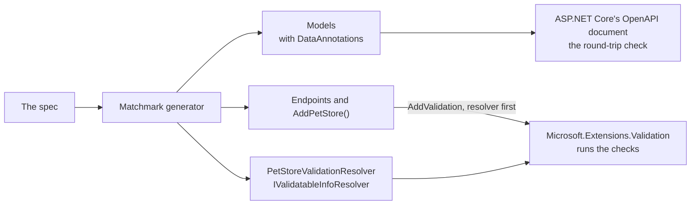

# Validation on .NET's validation layer

**Planned** (decision Q45, [decisions](../decisions.md#second-round)): adopted now, with the spike as its first
implementation step. Nothing on this page is built yet. It specifies how
Matchmark's per-object checks move onto .NET's own validation layer (`Microsoft.Extensions.Validation`, .NET 10), so a
generated service validates the way any .NET service does, and Matchmark stops maintaining a validator of its own.
Invariants across a collection, such as uniqueness, are not model validation: see [invariants](invariants.md#common-rules).

## Today

The `Contract` part generates `{Api}Validation`, Matchmark's own validator: one `Validate` method per model, returning
errors keyed by JSON path (`details.livesLeft`). Generated endpoints call it, and so does the generated client before it
sends. Generated models carry no DataAnnotations. The `Verify` part reads DataAnnotations on hand-written models, mapping
each attribute to a schema keyword (`Constraints.cs`), and the round-trip check compares ASP.NET Core's OpenAPI document
with the spec.

## What .NET provides

Read from the source of `dotnet/aspnetcore` (`src/Validation`), November 2026:

- **`Microsoft.Extensions.Validation`**, a package described as "validation infrastructure for .NET applications", not
  tied to ASP.NET Core. `AddValidation()` registers it; minimal APIs then validate parameters and bodies before the
  handler runs, and answer a validation problem.
- **A source generator** finds what to validate from minimal API handlers' parameters and from types marked
  `[ValidatableType]` ("to support discovery by the validations generator").
- **Resolvers.** `ValidationOptions.Resolvers` holds `IValidatableInfoResolver`s that supply validation metadata for
  types and parameters; "source-generated resolvers are typically inserted at the beginning of this list".
- **Async throughout.** `IValidatableTypeInfo.ValidateAsync`, `IValidatablePropertyInfo.ValidateAsync` and
  `IValidatableParameterInfo.ValidateAsync`, with errors gathered in a `ValidateContext`.
- **What runs:** DataAnnotations attributes, custom `ValidationAttribute`s, and `IValidatableObject`.

## The caveat that shapes the design

Roslyn source generators don't see each other's output. Microsoft's validations generator won't discover models that
Matchmark generates into the same project, and it finds endpoints from `Map…` calls, which Matchmark also generates. So
Matchmark **generates the resolver itself**, from the spec, and .NET runs the pipeline. The attributes still go on the
models: ASP.NET Core's OpenAPI document reads them, and hand-written code that uses the models gets them too.



## What the generator will add

### 1. Attributes on generated models and parameters

The mapping `Constraints.cs` already reads, written in the other direction. On each model property, and on each
generated endpoint parameter:

| Schema | Attribute | Notes |
|:--|:--|:--|
| `required` (non-nullable) | `[Required]` | reference types only; value types are required by their type |
| `minLength`, `maxLength` (string) | `[MinLength]`, `[MaxLength]` | as ASP.NET Core's OpenAPI document reads them today |
| `minItems`, `maxItems` (array) | `[Length(min, max)]` | .NET 8 |
| `minimum`, `maximum` | `[Range(min, max)]` | |
| `exclusiveMinimum`, `exclusiveMaximum` | `[Range(…, MinimumIsExclusive = true, MaximumIsExclusive = true)]` | .NET 8 |
| `pattern` | `[RegularExpression(pattern)]` | |
| string `enum`, `const` | `[AllowedValues(…)]` | .NET 8; enums typed as C# enums need none |
| `format: email` | `[EmailAddress]` | |
| `format: uri` | `[Url]` | |
| `format: byte` | `[Base64String]` | .NET 8 |
| `multipleOf` | `[MultipleOf(step)]` | Matchmark.Validation |
| `uniqueItems` | `[UniqueItems]` | Matchmark.Validation |
| `minProperties`, `maxProperties` (maps) | `[PropertyCount(min, max)]` | Matchmark.Validation |

Attributes that .NET doesn't have come from a new small package, **Matchmark.Validation**: the three above, written
once, not generated per API.

### 2. Rules across fields

`x-matchmark-rules` (CEL over `self`) on a schema: the generated model is a `partial record` implementing
`IValidatableObject`, whose `Validate` evaluates each rule with Matchmark.Rules and yields a `ValidationResult` naming the
fields the rule reads. Without Matchmark.Rules referenced, the rules aren't generated, as today (`MM025`).

### 3. The resolver

`{Api}ValidationResolver : IValidatableInfoResolver`, generated into the `Contract` part when the project references
`Microsoft.Extensions.Validation`. It describes every generated model and every generated endpoint parameter: its
properties, their attributes, its nested types and collection items, and whether it is an `IValidatableObject`. It is
what Microsoft's generator would have produced had it seen the types.

### 4. Registration

`Add{Api}()` (the `Server` part) calls:

```csharp
services.AddValidation(options => options.Resolvers.Insert(0, new PetStoreValidationResolver()));
```

Generated endpoints stop calling `{Api}Validation` and rely on the validation filter. **Error keys stay as they are:**
JSON paths in the spec's names (`details.livesLeft`, `[0].name`), so the suite's `RejectionNamesTheValue` check and
every client keep working.

### 5. What stays outside the validation layer

| Check | Where it stays | Why |
|:--|:--|:--|
| null versus absent, unknown members, a number for an enum, the wrong JSON type | the JSON serializer's settings (`RefuseNulls`, `{Api}EnumConverter`, unmapped-member handling) | these fail while the body is read, before there is a model to validate |
| `x-dependencies` between parameters (IDL) | a generated endpoint filter | an attribute sees one value; IDL relates several parameters |
| invariants across a collection | the service's storage, the twin and the suite | [invariants](invariants.md) |
| `oneOf` without a discriminator | `JsonElement`, unchecked (`MM009`) | as today |

### 6. The client

The generated client validates before sending with the same resolver, through `Microsoft.Extensions.Validation` outside
ASP.NET Core, so a bad request never leaves and returns the operation's validation case without a round trip, as today.
A contract-only package (`MatchmarkProblems="Owned"`) takes the package as its one new dependency.

## Diagnostics

| Id | Severity | When |
|:--|:--|:--|
| MM029 | Info | `Microsoft.Extensions.Validation` isn't referenced, so the contract keeps Matchmark's own validator. |
| MM030 | Warning | A schema keyword has no attribute (neither .NET's nor Matchmark.Validation's): it's checked by the suite only. |

## The spike

The first implementation step (Q45). What has to hold before Matchmark's own validator is retired, in the Pet Store and
the Bookings sample:

1. A contract compiled in its own project, with generated attributes and a generated resolver, is validated by
   `AddValidation()` in the service project.
2. Every existing suite still passes, the Bookings sample's CEL rules and IDL dependencies included
   (`GeneratedRulesTests`), with the same error keys.
3. The round-trip check still finds no differences, now that models carry attributes.
4. The generated client refuses the same bad requests before sending.

If 1 fails, Matchmark's resolver covers what .NET's generator can't see, as designed ([question 2](../QUESTIONS.md)). If
the layer can't keep the error keys or the checks, the fallback is to keep Matchmark's validator behind the same keys and
generate attributes for the OpenAPI document and hand-written code only. Either way the result is recorded in
[decisions](../decisions.md).

## Done when

Matchmark's own `{Api}Validation` is gone from generated code, every suite passes with the same error keys, and the
emitter is smaller by the validator's share, as the first slice of [the model](model.md).
