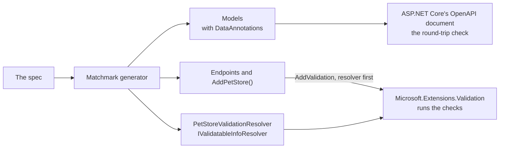

# Validation on .NET's validation layer

**Built, but for the client** (decision Q45, [decisions](../decisions.md#second-round)): adopted, with the spike as its
first implementation step. The spike is **Built** ([what it found](#what-the-spike-found)), and so are the attributes on
models, the resolver, and .NET's layer as the default, endpoint parameters included; moving the client and retiring
Matchmark's own validator wait on a question ([status](#status)). It specifies how
Matchmark's per-object checks move onto .NET's own validation layer (`Microsoft.Extensions.Validation`, .NET 10), so a
generated service validates the way any .NET service does, and Matchmark stops maintaining a validator of its own.
Invariants across a collection, such as uniqueness, are not model validation: see [invariants](invariants.md#common-rules).

## Today

The `Contract` part generates `{Api}Validation`, Matchmark's own validator: one `Validate` method per model, returning
errors keyed by JSON path (`details.livesLeft`). Generated endpoints call it, and so does the generated client before it
sends. Generated models carry no DataAnnotations. The `Verify` part reads DataAnnotations on hand-written models, mapping
each attribute to a schema keyword (`Constraints.cs`), and the round-trip check compares ASP.NET Core's OpenAPI document
with the spec.

## What .NET provides

Read from the source of `dotnet/aspnetcore` (`src/Validation`), November 2026:

- **`Microsoft.Extensions.Validation`**, a package described as "validation infrastructure for .NET applications", not
  tied to ASP.NET Core. `AddValidation()` registers it; minimal APIs then validate parameters and bodies before the
  handler runs, and answer a validation problem.
- **A source generator** finds what to validate from minimal API handlers' parameters and from types marked
  `[ValidatableType]` ("to support discovery by the validations generator").
- **Resolvers.** `ValidationOptions.Resolvers` holds `IValidatableInfoResolver`s that supply validation metadata for
  types and parameters; "source-generated resolvers are typically inserted at the beginning of this list".
- **Async throughout.** `IValidatableTypeInfo.ValidateAsync`, `IValidatablePropertyInfo.ValidateAsync` and
  `IValidatableParameterInfo.ValidateAsync`, with errors gathered in a `ValidateContext`.
- **What runs:** DataAnnotations attributes, custom `ValidationAttribute`s, and `IValidatableObject`.

## The caveat that shapes the design

Roslyn source generators don't see each other's output. Microsoft's validations generator won't discover models that
Matchmark generates into the same project, and it finds endpoints from `Map…` calls, which Matchmark also generates. So
Matchmark **generates the resolver itself**, from the spec, and .NET runs the pipeline. The attributes still go on the
models: ASP.NET Core's OpenAPI document reads them, and hand-written code that uses the models gets them too.



## What the generator will add

### 1. Attributes on generated models and parameters

**Built on model properties** (`ModelAttributeTests`); endpoint parameters are **Planned**. The mapping `Constraints.cs`
already reads, written in the other direction:

| Schema | Attribute | Notes |
|:--|:--|:--|
| `required` | none: the C# `required` member | System.Text.Json refuses a body without it, and ASP.NET Core's OpenAPI document reads `required` members; `[Required]` would also refuse an empty string the spec allows |
| `minLength`, `maxLength` (string) | `[MinLength]`, `[MaxLength]` | **Built**; as ASP.NET Core's OpenAPI document reads them |
| `minItems`, `maxItems` (array) | `[MinLength]`, `[MaxLength]` | **Built**; on a collection they count items, and the OpenAPI document writes them as `minItems`, `maxItems` |
| `minimum` and `maximum` | `[Range(min, max)]` | **Built**. A one-sided bound has no attribute (`Range` needs both); the generated validator checks it |
| `exclusiveMinimum`, `exclusiveMaximum` | `[Range(…, MinimumIsExclusive = true, MaximumIsExclusive = true)]` | **Built**, with the other bound as above |
| `pattern` | `[RegularExpression(pattern)]` | **Built** |
| string `enum` kept as text | `[AllowedValues(…)]` | **Built**; an enum schema of its own is a C# enum, which needs none |
| `format: email` | `[EmailAddress]` | **Built**. .NET's check is looser than a full address grammar |
| `format: uri` | `[Url]` | **Built** |
| `format: byte` | `[Base64String]` | **Built** |
| `const` (string) | `[AllowedValues(value)]` | **Built**; with `null` too when the property may be absent |
| `multipleOf` | `[MultipleOf(step)]` | **Built**; Matchmark.Validation, compared in decimal |
| `uniqueItems` | `[UniqueItems]` | **Built**; Matchmark.Validation, items compared as JSON |
| `minProperties`, `maxProperties` (maps) | `[PropertyCount(min, max)]` | **Built**; Matchmark.Validation, -1 for no bound |

Attributes that .NET doesn't have come from a new small package, **Matchmark.Validation** (**Built**): the three above,
written once, not generated per API, and generated only when the project references it. Matchmark's own validator
checks none of these three, so on .NET's layer they're new checks, not moved ones.

### 2. Rules across fields

**Built.** `x-matchmark-rules` (CEL over `self`) on a schema: the generated model implements `IValidatableObject`, whose
`Validate` evaluates each rule with Matchmark.Rules (through `{Api}Validation.Broken`) and yields a `ValidationResult`
per broken rule, keyed at the model as Matchmark's validator keys it (`$` for the whole body). .NET runs it once the
model's own attributes hold. Without Matchmark.Rules referenced, the rules aren't generated, as today (`MM025`).

### 3. The resolver

**Built.** `{Api}ValidationResolver : IValidatableInfoResolver`, generated into the `Contract` part when the project
references `Microsoft.Extensions.Validation` (every .NET 10 web project does: it's in the shared framework). It describes
every generated model: each property by its C# name (the layer finds it by reflection), shown by its JSON name, with the
same attributes the model carries; nested models and collection items are found through it. A body parameter of a
generated type is validated, and its errors re-keyed from C# paths to the spec's JSON paths (`Details.LivesLeft` to
`details.livesLeft`, `[0].name` for a list body). Rules as `IValidatableObject` are **Built** (step 2 above).

### 4. Registration

**Built as an opt-in:** `services.Add{Api}Validation()`, generated beside the resolver, is

```csharp
services.AddValidation(options => options.Resolvers.Insert(0, new PetStoreValidationResolver()));
```

**Built:** `Add{Api}()` calls it, so it's the default ([status](#status)).

Generated endpoints stop calling `{Api}Validation` and rely on the validation filter. **Error keys stay as they are:**
JSON paths in the spec's names (`details.livesLeft`, `[0].name`), so the suite's `RejectionNamesTheValue` check and
every client keep working.

### 5. What stays outside the validation layer

| Check | Where it stays | Why |
|:--|:--|:--|
| null versus absent, unknown members, a number for an enum, the wrong JSON type | the JSON serializer's settings (`RefuseNulls`, `{Api}EnumConverter`, unmapped-member handling) | these fail while the body is read, before there is a model to validate |
| `x-dependencies` between parameters (IDL) | a generated endpoint filter | an attribute sees one value; IDL relates several parameters |
| invariants across a collection | the service's storage, the twin and the suite | [invariants](invariants.md) |
| `oneOf` without a discriminator | `JsonElement`, unchecked (`MM009`) | as today |

### 6. The client

The generated client validates before sending with the same resolver, through `Microsoft.Extensions.Validation` outside
ASP.NET Core, so a bad request never leaves and returns the operation's validation case without a round trip, as today.
A contract-only package (`MatchmarkProblems="Owned"`) takes the package as its one new dependency.

## Status

| Slice | State | Evidence |
|:--|:--|:--|
| The spike | **Built** | `ValidationSpikeTests`; decision Q54 |
| 1. Attributes on generated models | **Built** | `ModelAttributeTests`; every suite and the round-trip check pass |
| 2. The resolver, opt-in | **Built** | `ModelAttributeTests` sends the same bad bodies with and without it: the same statuses and error keys. `SpecRegressionTests` runs the Pet Store's whole suite, random requests included, with it registered, and .NET's layer answers some bad bodies itself |
| 3. The default | **Built** | `Add{Api}()` registers the resolver: emitted in the same project, or found by the spec's type name (`{namespace}.{Api}ValidationResolver`) in a referenced contract project, the Pet Store's layout. Every suite passes on it. |
| 3. Endpoint parameters | **Built** | The resolver describes the generated endpoints' path, query and header values (bound with `[FromRoute]`, `[FromQuery]`, `[FromHeader(Name = …)]`), keyed by their names in the spec, so one pass reports a bad header and a bad body together, as the Ledger's suite needs. A name two operations constrain differently is left to the endpoint's own check. |
| 3. The client, and retiring `{Api}Validation` | Planned, on a question | The generated client runs outside ASP.NET; moving it means each client package depends on Microsoft.Extensions.Validation, still experimental ([question 3](../QUESTIONS.md)). Until then `{Api}Validation` stays: the client uses it, and the endpoints run it after .NET's layer, for what that layer doesn't see (forms, deep query objects, `x-dependencies`), and as the check when `Add{Api}()` isn't called. |

What differed when .NET's layer answered, found by slice 2, and how slice 3 closed it: the keys and statuses were the
same, but the messages were .NET's (*The field sides must be between 3 and 12.*). The resolver now gives each attribute
Matchmark's own message, and a range is one attribute per bound (so *Must be at least 3.*, and a one-sided bound is
checked too); the scaffolded MVC controllers, which still answer with Matchmark's validator, read exactly the same.
Without `AddProblemDetails()` the problem body has no `type` or `status`, as for any minimal API. The comparison also found two gaps in Matchmark's
own validator, now fixed: it ignored `exclusiveMinimum` and `exclusiveMaximum`, and didn't check `format: byte`.

## Diagnostics

| Id | Severity | When |
|:--|:--|:--|
| MM029 (**Built**) | Info | `Microsoft.Extensions.Validation` isn't referenced, so the contract keeps Matchmark's own validator. |
| MM030 (**Built**) | Info | A schema keyword has no attribute (neither .NET's nor Matchmark.Validation's): it's checked by the suite only. |

## The spike

The first implementation step (Q45). What has to hold before Matchmark's own validator is retired, in the Pet Store and
the Bookings sample:

1. A contract compiled in its own project, with generated attributes and a generated resolver, is validated by
   `AddValidation()` in the service project.
2. Every existing suite still passes, the Bookings sample's CEL rules and IDL dependencies included
   (`GeneratedRulesTests`), with the same error keys.
3. The round-trip check still finds no differences, now that models carry attributes.
4. The generated client refuses the same bad requests before sending.

If 1 fails, Matchmark's resolver covers what .NET's generator can't see, as designed. If the layer can't keep the error
keys or the checks, the fallback is to keep Matchmark's validator behind the same keys and generate attributes for the
OpenAPI document and hand-written code only. Either way the result is recorded in [decisions](../decisions.md).

### What the spike found

**Built** as `ValidationSpikeTests` (what the generator would emit, written by hand), and a two-project build, on .NET
10.0.14, where `Microsoft.Extensions.Validation` ships in the ASP.NET Core shared framework (marked experimental,
`ASP0029`):

| Finding | Consequence |
|:--|:--|
| A resolver inserted first in `ValidationOptions.Resolvers` makes minimal APIs validate a body parameter, nested models and `IValidatableObject` included, with no help from Microsoft's generator. | Condition 1 holds: the design works. |
| `ValidatablePropertyInfo` finds the property by reflection on its `Name`, so `Name` must be the C# name; the error key is the path of `Name`s (`Details.LivesLeft`), and the display name (the JSON name) only reaches the message. | The layer alone can't keep the spec's keys. |
| The generated parameter info can translate keys after validating: it runs the base validation into its own error dictionary, then maps each C# path to the JSON path through the models' `[JsonPropertyName]`s (`details.livesLeft`). | The spec's keys are kept in one generated place, not per property. |
| A rule across fields (`IValidatableObject`) is keyed by the member names its `ValidationResult` gives, as written. | Generated rules name the JSON field, as `{Api}Validation` does today. |
| Microsoft's generator validates a model in a referenced project when it sees a `Map` call taking it, but under C# keys (decision Q54). | Matchmark generates the resolver for everything. |

Conditions 2 to 4 (every suite with the same keys, the round trip, the client) need the generator to emit the
attributes and the resolver; that's the next step.

## Done when

Matchmark's own `{Api}Validation` is gone from generated code, every suite passes with the same error keys, and the
emitter is smaller by the validator's share, as the first slice of [the model](model.md).
